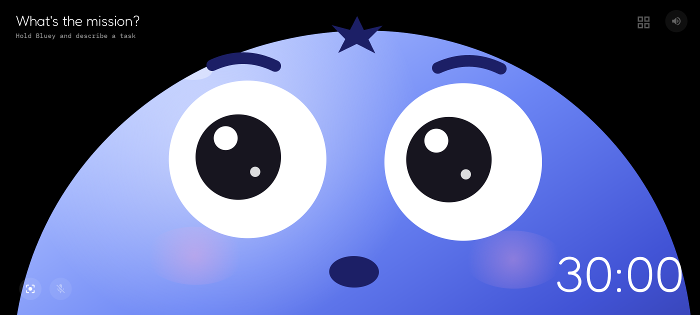
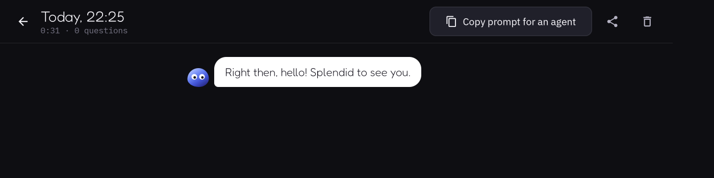
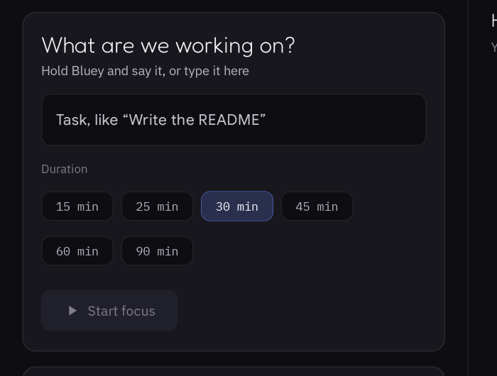
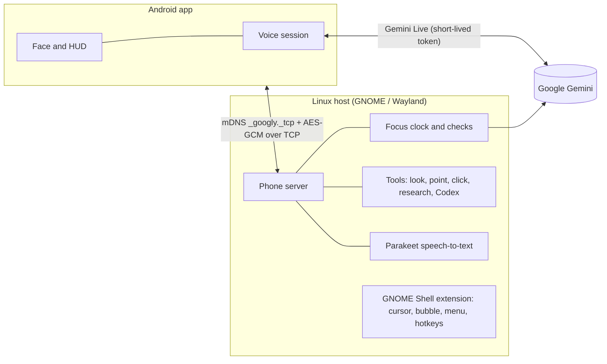

# Bluey for Android and Linux

A blueberry focus friend that lives on your phone, propped up under your monitor. His googly eyes follow your mouse,
you hold his face to ask for something, and he keeps you company through timed focus sessions while your computer
checks, gently, whether you're still on task.

This repository ports [Bluey by Riley](https://github.com/rbrown101010/bluey-by-riley) (iPhone + Mac) to an
**Android app** and a **Linux host for GNOME on Wayland**. Pairing, discovery and the encrypted link stay
byte-for-byte compatible with the original apps.

<p align="center">
  
</p>

| Conversation | Focus |
|---|---|
|  |  |

## What it does

- **Face** – full-screen landscape character with spring-driven eyes, blinks and moods. His gaze follows your
  mouse on the computer, and his mouth moves while he talks.
- **Hold to ask** – hold his face, speak, let go. Speech is transcribed **on your computer** with
  Parakeet when available, so your voice never leaves your network. He answers
  out loud and in a speech bubble on the phone and next to his own cursor on screen.
- **Focus sessions** – say or type a task and a duration. The computer owns the clock, looks at the screen every
  30 seconds and nudges you after repeated off-task checks. Each session ends as a timeline of on-task and off-task
  checks you can inspect.
- **Using the computer** – on request he can look at the screen, point at things, research the web, click, type,
  scroll, open apps and links, and hand coding jobs to Codex.
- **Conversations** – every voice session is kept on the phone and written to `~/Documents/Bluey Notes` on the
  computer as Markdown that any agent can read.

## How it fits together



- **Discovery** – the host advertises `_googly._tcp` with a public `bluey-id` fingerprint.
- **Pairing** – a one-time QR code carries a 256-bit secret. Every connection proves knowledge of it with an HMAC
  challenge and then uses direction-specific HKDF keys for ordered AES-GCM records, so eavesdropping, tampering and
  replay fail.
- **Keys** – the Gemini API key stays on the computer. The phone only receives short-lived Live tokens locked to
  Bluey's session setup.

The full protocol, command list and state machines are in [docs/PROTOCOL.md](docs/PROTOCOL.md).

## Repository layout

| Path | What |
|---|---|
| [`android/`](android) | Kotlin + Jetpack Compose app (minSdk 26, target 35) |
| [`linux/`](linux) | Python host: phone server, focus, tools, Gemini, notes, Codex ([details](linux/README.md)) |
| [`linux/gnome-extension/`](linux/gnome-extension) | GNOME Shell extension for the overlay, pointer, panel menu and hotkeys |
| [`docs/`](docs) | Protocol notes and screenshots |

## Getting started

### 1. Linux host

Needs GNOME on Wayland, Python 3.11+, PyGObject with GTK 4 and libadwaita, `python-cryptography`, `avahi`,
`qrencode` and `ydotool` (for computer control). Optional: `codex`, `tesseract` (screen text), and
Voxtype configured with the Parakeet engine for local speech recognition.

```sh
git clone https://github.com/norobb/bluey-by-riley-android
cd bluey-by-riley-android/linux
ln -s "$PWD/gnome-extension/bluey@googly-eyes" ~/.local/share/gnome-shell/extensions/
gnome-extensions enable bluey@googly-eyes   # takes effect after logging out and in
python3 -m bluey.app --pair
```

Enter a [Gemini API key](https://aistudio.google.com/apikey) when asked. The phone connects on TCP port **47321**,
so allow it from your LAN if a firewall is active, for example
`sudo ufw allow from 192.168.0.0/16 to any port 47321 proto tcp`.
To start with every login, see the systemd unit in [linux/README.md](linux/README.md).

### 2. Android app

```sh
cd android
./gradlew :app:assembleDebug
adb install -r app/build/outputs/apk/debug/app-debug.apk
```

Open Bluey, tap **Scan pairing code** and scan the QR code from the computer. Both devices must be on the same network.
CI builds a debug APK on every push; download it from the latest workflow run.

## Tests

```sh
cd android && ./gradlew :app:testDebugUnitTest   # crypto vectors, handshake, pairing, packets, focus rules
cd linux && python3 -m unittest discover -s tests # same vectors, focus clock and nudges, local speech
```

Crypto test vectors were generated independently with Python `cryptography` and RFC 5869.

## Compatibility

| | Original Mac | Linux host |
|---|---|---|
| **Original iPhone** | everything | pairing, focus, face and tools; no voice (the iPhone speaks OpenAI Realtime) |
| **Android app** | pairing, focus and face; no voice (the Mac mints OpenAI tokens) | everything |

## Privacy

During a focus session the computer sends a reduced screenshot of its main display, the task, timings and recent
check results to Google Gemini. Screenshots are kept in memory and deleted at once, never saved by Bluey. Pause,
end, lock, sleep or a lost connection stop the checks, and resuming is always manual. Gemini's processing and
retention follow your Google API terms.

## Credits and license

Based on [Bluey by Riley](https://github.com/rbrown101010/bluey-by-riley), released into the public domain. This port
is released under the same terms, see [LICENSE](LICENSE). Bundled fonts (Fredoka, IBM Plex) are under the SIL Open
Font License, see [android/licenses](android/licenses).
